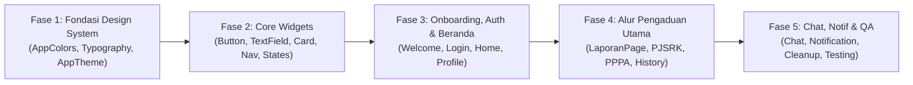

# SENTRA Mobile — UI/UX Design System & Improvement Plan

> **Versi Dokumen**: 1.0  
> **Aplikasi**: SENTRA (Aplikasi Pengaduan by DPPPA Nganjuk)  
> **Platform**: Flutter (Android & iOS) — Fokus **Light Mode**  
> **Arah Visual**: Menjadikan bahasa visual modern pada `BerandaScreen` & `PjsrkScreen` (surface `#F5F7F9`, kartu putih ber-border halus, aksen warna per layanan) sebagai standar tunggal seluruh aplikasi.

---

## 1. Visi Desain & Prinsip UX

Aplikasi SENTRA melayani masyarakat dalam situasi sensitif dan sering kali mendesak (pengaduan kekerasan perempuan/anak, bencana alam, rehabilitasi & permasalahan sosial). Oleh karena itu, seluruh keputusan UI/UX harus berpegang pada 4 prinsip berikut:

1. **Calm & Trustworthy (Tenang & Tepercaya)**
   - Gunakan latar bersih (`#F5F7F9` / `#FAFBFC`) dan kartu putih (`#FFFFFF`) agar konten mudah dibaca tanpa distraksi gradasi berat.
   - Hindari efek bayangan pekat atau bentuk tombol tajam/asimetris yang terasa usang.
2. **Low Cognitive Load (Beban Kognitif Rendah)**
   - Pecah form panjang (seperti `LaporanPage`) menjadi kelompok kartu terstruktur dengan indikator progres (*stepper*) yang jelas dan satu aksi utama (*sticky bottom CTA*) per langkah.
   - Prioritaskan akses cepat untuk pelaporan darurat tanpa hambatan animasi panjang.
3. **Consistent Service Identity (Identitas Layanan Konsisten)**
   - Setiap pilar layanan memiliki aksen warna yang konsisten dari Beranda hingga layar detail dan form:
     - **SENTRA / PPPA**: Hijau (`#389753` / `#52AE77`)
     - **PJSRK**: Oranye (`#D6762C` / `#E57E3B`)
     - **PSK**: Indigo (`#5B6BBF`)
4. **Accessible & Native-Feeling (Aksesibel & Responsif)**
   - Target sentuh minimal **48×48 dp**, umpan balik sentuh (`InkWell` + `HapticFeedback`), kontras teks minimal **WCAG AA (4.5:1)**, bahasa antarmuka **100% Bahasa Indonesia** yang konsisten, serta aman terhadap *system font scaling* (`TextScaler`) dan *keyboard inset*.

---

## 2. Audit UI Saat Ini & Pemetaan Masalah

Hasil audit terhadap codebase Flutter saat ini menunjukkan kesenjangan kualitas visual antara modul baru dan modul lama:

| Area / File | Temuan Masalah | Dampak UX | Prioritas |
| :--- | :--- | :--- | :---: |
| `lib/main.dart` | `ThemeData` hanya mengatur `fontFamily: 'Mulish'` tanpa `ColorScheme`, `TextTheme`, atau tema komponen. | Gaya widget harus diulang manual di setiap layar; rawan inkonsistensi. | **Tinggi** |
| `lib/core/utils/app_colors.dart` | Penamaan warna non-semantik (`backgroundijotuek`, `birunom`, `kuningtuek`, `oren`) & bug `Color.fromRGBO(..., 100)` (opacity seharusnya `0.0–1.0`). | Sulit dipelihara; warna tombol berpotensi tidak sesuai intensi. | **Tinggi** |
| `lib/features/pjsrk/views/widgets/pjsrk_colors.dart` | Palet warna terpisah dari `core`; banyak hex *hardcoded* di layar lain. | Warna status & surface tidak seragam antar fitur. | **Tinggi** |
| `lib/core/utils/custom_button.dart` | Sudut diagonal asimetris (`topLeft: 20, bottomRight: 20`), memakai `GestureDetector` (tanpa efek ripple), shadow hitam pekat (`opacity 0.25`). | Terasa tidak responsif dan kontras gaya dengan tombol modern di `BerandaScreen` & `PjsrkScreen`. | **Tinggi** |
| `lib/core/utils/custom_text_field.dart` | `labelStyle` berukuran `20px` dengan `contentPadding` vertikal `5px`. | Input terasa sempit dan proporsi label tidak seimbang. | **Tinggi** |
| `lib/core/utils/custom_snackbar.dart` | Posisi margin dihitung dengan `MediaQuery.size.height - tinggi!`. | Rentan *overflow* atau terpotong saat keyboard aktif / layar kecil. | **Tinggi** |
| Navigasi Bawah (4 versi) | Terdapat 4 implementasi berbeda: `core/utils/navbar.dart`, `HomeScreen._BottomNavBar`, `PjsrkBottomNav`, `LaporanSayaBottomNav`. | Pengalaman navigasi berbeda-beda antar modul. | **Tinggi** |
| `lib/features/report/views/report_screen.dart` | File monolitik **3.343 baris**; form panjang dalam satu alur padat. | Pengguna mudah lelah mengisi form; sulit dirawat secara visual. | **Tinggi** |
| `lib/features/welcome/welcome_screen.dart` | Animasi intro 6 detik + audio otomatis (`welcome.mp3`) tanpa tombol skip/mute yang menonjol. | Menghambat pengguna yang ingin segera melapor dalam kondisi darurat. | **Sedang** |
| `lib/features/auth/views/login_screen.dart` | Memakai `MediaQuery.textScaleFactor` (deprecated), tombol diagonal lama, label campuran Inggris (*"Sign in"*, *"Sign up"*). | Tampilan auth tertinggal dibanding Beranda; berpotensi bermasalah di Flutter terbaru. | **Sedang** |
| `lib/features/auth/views/profile_screen.dart` & `history_screen.dart` | Header memakai gradasi hijau–biru berat (`backgroundIjo` → `backgroundBiru`); empty state polos (*"No reports available"*). | Tidak selaras dengan header bersih di `BerandaScreen` & `PppaScreen`. | **Sedang** |
| `lib/features/dashboard/views/dashboard_screen.dart` | Container latar memakai `LinearGradient` 4 warna putih semua; card informasi & grafik masih memakai shadow keras (`Colors.black12`). | Redundan secara kode dan kurang hierarki visual. | **Sedang** |
| `lib/features/pjsrk/views/widgets/` | Duplikasi file akibat typo nama: `pjrsk_check_row.dart` vs `pjsrk_check_row.dart`, `pjrsk_summary_card.dart` vs `pjsrk_summary_card.dart`. | Risiko mengedit file yang salah dan menambah beban maintenance. | **Rendah** |

---

## 3. Design System & Token Terpusat (`lib/core/theme/`)

Seluruh token desain akan dipusatkan di folder baru `lib/core/theme/`:
- `lib/core/theme/app_colors.dart` — Token warna semantik & palet layanan
- `lib/core/theme/app_typography.dart` — Skala tipografi `Mulish`
- `lib/core/theme/app_spacing.dart` — Spacing, radius, dan elevation/shadow
- `lib/core/theme/app_theme.dart` — `ThemeData` terpusat untuk `MaterialApp`

### 3.1 Color Tokens

#### A. Brand & Surface (Light Mode)
| Token | Hex | Kegunaan |
| :--- | :--- | :--- |
| `AppColors.primary` | `#3B8F5F` | Warna utama SENTRA (CTA, tab aktif, focus border) |
| `AppColors.primaryDark` | `#2E744C` | Pressed state, header solid, aksen gelap |
| `AppColors.primarySoft` | `#EBF6EF` | Latar pill aktif, badge, icon container |
| `AppColors.background` | `#F5F7F9` | Latar utama seluruh `Scaffold` |
| `AppColors.surface` | `#FFFFFF` | Permukaan kartu, sheet, dialog, input field |
| `AppColors.surfaceVariant` | `#F1F4F7` | Latar chip non-aktif, input read-only, search bar |
| `AppColors.border` | `#E5E9EF` | Garis tepi kartu, divider, border input default |
| `AppColors.textPrimary` | `#1E293B` | Judul, isi utama, label aktif |
| `AppColors.textSecondary` | `#64748B` | Subjudul, deskripsi kartu, metadata |
| `AppColors.textMuted` | `#94A3B8` | Hint text, placeholder, timestamp |

#### B. Service Identity Palette
| Layanan | Primary | Dark / Gradient End | Soft Tint (Icon/Badge) |
| :--- | :--- | :--- | :--- |
| **PPPA / SENTRA** | `#48B167` | `#389753` | `#E8F7ED` |
| **PJSRK** | `#D6762C` | `#C76A22` | `#FCEBDC` |
| **PSK** | `#5B6BBF` | `#4856A6` | `#EEF0FA` |

#### C. Semantic & Status Laporan
| Status / Makna | Foreground | Background Soft | Ikon Rekomendasi |
| :--- | :--- | :--- | :--- |
| **Terkirim / Warning** | `#B45309` | `#FEF3C7` | `Icons.send_rounded` |
| **Diterima / Info** | `#1D4ED8` | `#DBEAFE` | `Icons.inbox_rounded` |
| **Diproses** | `#C2410C` | `#FFEDD5` | `Icons.autorenew_rounded` |
| **Selesai / Success** | `#15803D` | `#DCFCE7` | `Icons.check_circle_rounded` |
| **Ditolak / Error** | `#B42318` | `#FEE2E2` | `Icons.cancel_outlined` |

### 3.2 Typography Scale (`Mulish`)

> Catatan: Pastikan seluruh bobot font yang dipakai (`Regular 400`, `Medium 500`, `SemiBold 600`, `Bold 700`, `ExtraBold 800`) tersedia di `assets/font/` dan terdaftar di `pubspec.yaml` agar tidak terjadi *faux bold* di Android/iOS.

| Style Name | Size | Weight | Line Height | Kegunaan |
| :--- | :---: | :---: | :---: | :--- |
| `displaySmall` | 28 sp | 800 | 1.25 | Hero judul Welcome / Overview |
| `headlineMedium` | 22 sp | 700 | 1.30 | Judul halaman utama / Sapaan Beranda |
| `headlineSmall` | 18 sp | 700 | 1.35 | Judul AppBar, judul dialog, header section besar |
| `titleMedium` | 16 sp | 700 | 1.40 | Judul kartu layanan, sub-section header |
| `titleSmall` | 14 sp | 700 | 1.40 | Label tombol, judul item list |
| `bodyLarge` | 15 sp | 500 | 1.50 | Input teks, paragraf kronologi |
| `bodyMedium` | 14 sp | 400 | 1.50 | Deskripsi umum, isi chat bubble |
| `bodySmall` | 12 sp | 500 | 1.45 | Subjudul kartu, helper text, tanggal |
| `labelSmall` | 11 sp | 700 | 1.20 | Badge status, tag chip, label bottom nav |

### 3.3 Spacing, Border Radius & Elevation

- **Spacing Grid (kelipatan 4dp)**: `xs = 4`, `sm = 8`, `md = 12`, `lg = 16`, `xl = 20`, `xxl = 24`, `section = 32`.
- **Padding Halaman Standar**: `EdgeInsets.symmetric(horizontal: 16)` (atau `20` untuk form auth/onboarding).
- **Border Radius**:
  - `radiusSm = 8` (badge, tag kecil)
  - `radiusMd = 12` (input field, button standar, snackbar)
  - `radiusLg = 16` (kartu konten, item riwayat, bubble chat)
  - `radiusXl = 20–24` (kartu layanan hero, dialog, bottom nav top)
  - `radiusSheet = 28` (bottom sheet & curved content sheet)
  - `radiusPill = 999` (filter chip, avatar, pill indicator)
- **Elevation / Shadow**:
  - **Card Default**: Border `1px #E5E9EF` + soft shadow `BoxShadow(color: Color(0x0D0F172A), blurRadius: 12, offset: Offset(0, 4))`.
  - **Floating / Bottom Bar**: `BoxShadow(color: Color(0x140F172A), blurRadius: 16, offset: Offset(0, -4))`.

### 3.4 Blueprint `AppTheme` (`lib/core/theme/app_theme.dart`)

```dart
ThemeData buildSentraTheme() {
  const colorScheme = ColorScheme.light(
    primary: Color(0xFF3B8F5F),
    onPrimary: Colors.white,
    secondary: Color(0xFFD6762C),
    onSecondary: Colors.white,
    surface: Colors.white,
    onSurface: Color(0xFF1E293B),
    error: Color(0xFFB42318),
    onError: Colors.white,
    outline: Color(0xFFE5E9EF),
  );

  return ThemeData(
    useMaterial3: true,
    fontFamily: 'Mulish',
    colorScheme: colorScheme,
    scaffoldBackgroundColor: const Color(0xFFF5F7F9),
    appBarTheme: const AppBarTheme(
      backgroundColor: Colors.white,
      foregroundColor: Color(0xFF1E293B),
      elevation: 0,
      scrolledUnderElevation: 1,
      centerTitle: false,
    ),
    cardTheme: CardThemeData(
      color: Colors.white,
      elevation: 0,
      shape: RoundedRectangleBorder(
        borderRadius: BorderRadius.circular(16),
        side: const BorderSide(color: Color(0xFFE5E9EF)),
      ),
    ),
    inputDecorationTheme: InputDecorationTheme(
      filled: true,
      fillColor: Colors.white,
      contentPadding: const EdgeInsets.symmetric(horizontal: 14, vertical: 14),
      border: OutlineInputBorder(
        borderRadius: BorderRadius.circular(12),
        borderSide: const BorderSide(color: Color(0xFFE5E9EF)),
      ),
      enabledBorder: OutlineInputBorder(
        borderRadius: BorderRadius.circular(12),
        borderSide: const BorderSide(color: Color(0xFFE5E9EF)),
      ),
      focusedBorder: OutlineInputBorder(
        borderRadius: BorderRadius.circular(12),
        borderSide: const BorderSide(color: Color(0xFF3B8F5F), width: 1.6),
      ),
      errorBorder: OutlineInputBorder(
        borderRadius: BorderRadius.circular(12),
        borderSide: const BorderSide(color: Color(0xFFB42318)),
      ),
    ),
    elevatedButtonTheme: ElevatedButtonThemeData(
      style: ElevatedButton.styleFrom(
        backgroundColor: const Color(0xFF3B8F5F),
        foregroundColor: Colors.white,
        minimumSize: const Size(double.infinity, 50),
        elevation: 0,
        shape: RoundedRectangleBorder(borderRadius: BorderRadius.circular(12)),
      ),
    ),
  );
}
```

---

## 4. Konsolidasi Komponen UI (`lib/core/widgets/`)

Gantikan komponen tersebar dan tidak seragam dengan pustaka komponen inti yang bisa dipakai lintas modul (termasuk menerima parameter `accentColor` untuk modul PJSRK/PPPA):

| Komponen Baru | Menggantikan | Spesifikasi Utama |
| :--- | :--- | :--- |
| `SentraButton` | `CustomRoundedButton`, tombol manual di `login_screen.dart`, `pjsrk_gradient_button.dart` | Mendukung varian `primary`, `secondary`, `outlined`, `danger`; tinggi 48–50dp; radius `12px` simetris; memakai `ElevatedButton`/`OutlinedButton` (ada ripple & disabled state); state `isLoading` built-in. |
| `SentraTextField` | `CustomTextField`, `pjsrk_text_box.dart`, `pjsrk_text_field.dart`, `pppa_text_field.dart` | Label jelas di atas field (`13px w700 #1E293B`), hint `14px #94A3B8`, padding vertikal `14px`, dukungan prefix/suffix icon, counter karakter, dan pesan error rapi di bawah field. |
| `SentraCard` | Container berulang di `dashboard`, `history`, `pjsrk`, `profile` | Permukaan `#FFFFFF`, border `1px #E5E9EF`, radius `16px`, soft shadow opsional, serta dukungan `InkWell` untuk kartu interaktif. |
| `SentraAppBar` | Header manual di `profile`, `history`, `pppa`, `pjsrk`, `notification` | 2 varian: `clean` (putih + judul gelap + back button) dan `branded` (solid/soft-accent header sesuai warna layanan dengan `SystemUiOverlayStyle.light`). |
| `SentraBottomNav` | `core/utils/navbar.dart`, `HomeScreen._BottomNavBar`, `PjsrkBottomNav`, `LaporanSayaBottomNav` | Satu komponen bottom nav berbasis pill-indicator (seperti `HomeScreen._BottomNavBar`), mendukung 2–4 item dan `activeColor` per modul (Hijau untuk Beranda/PPPA, Oranye untuk PJSRK). |
| `SentraStatusBadge` | Logika warna/ikon status berulang di `history`, `pjsrk_tracking_card`, `notification` | Mapping tunggal status laporan (`Terkirim`, `Diterima`, `Diproses`, `Selesai`, `Ditolak`) menjadi pill badge berwarna semantik + ikon. |
| `SentraEmptyState` & `SentraErrorState` | Teks polos `"No reports available"` dan layout error manual | Ilustrasi/ikon dalam lingkaran soft tint, judul singkat, deskripsi ramah dalam Bahasa Indonesia, dan tombol aksi (`Coba Lagi` / `Buat Laporan`). |
| `SentraSnackbar` | `CustomSnackbar` (`MediaQuery.size.height - tinggi!`) | Floating snackbar standar Material di bagian bawah (aman dari keyboard & notch), radius `12px`, ikon semantik (success/warning/error/info), serta tombol dismiss/aksi. |

### Pembersihan File Duplikat / Legacy
Setelah konsolidasi komponen selesai, jadwalkan pembersihan:
- Hapus file typo duplikat di `lib/features/pjsrk/views/widgets/`: `pjrsk_check_row.dart`, `pjrsk_summary_card.dart`, `pjrsk_font_scope.dart` (verifikasi referensi import sebelum menghapus).
- Pensiunkan `lib/core/utils/navbar.dart` jika sudah tidak dipakai.
- Hapus script bantu sementara di root jika tidak diperlukan (`tool_edit_login.js`, `pjsrk_out.txt`).

---

## 5. Spesifikasi Redesign per Layar (Screen-by-Screen Plan)

### 5.1 Onboarding & Autentikasi

#### 1. `SplashScreen` & `WelcomeWithSplashScreen` (`lib/features/splash/`, `lib/features/welcome/welcome_screen.dart`)
- **Masalah**: Animasi intro 6 detik terlalu lambat; audio otomatis berisiko mengganggu pengguna yang sedang dalam situasi darurat; file 1.359 baris mencampur logika welcome dengan form.
- **Perbaikan**:
  - Pangkas durasi animasi intro menjadi **1.5–2.0 detik** dengan transisi fade + subtle slide yang halus.
  - Tambahkan tombol **Mute / Unmute** kecil di pojok kanan atas untuk `welcome.mp3` (atau jadikan audio opt-in).
  - Susun hierarki CTA yang tegas di bagian bawah:
    1. **CTA Utama (Darurat / Cepat)**: Tombol penuh *"Pelaporan Cepat (Tanpa Login)"* dengan ikon kilat/perisai agar mudah ditemukan dalam 1 detik.
    2. **CTA Sekunder**: Tombol *"Masuk / Daftar Akun"* (outlined/tonal) di bawahnya.
  - Pisahkan modal/sheet form dari `welcome_screen.dart` agar layar fokus pada onboarding.

#### 2. `LoginPage` & `GantiNomorScreen` (`lib/features/auth/views/`)
- **Masalah**: Sudut tombol diagonal asimetris, label *"Sign in / Sign up"* (Inggris), penggunaan `MediaQuery.textScaleFactor`, jarak antar field bergantung pada persentase `screenHeight`.
- **Perbaikan**:
  - Ganti tab underline manual dengan **Segmented Control** modern (`Masuk` | `Daftar`) berlatar `#F1F4F7` dengan pill putih aktif.
  - Gunakan `SentraTextField` dan `SentraButton` (radius `12px`, tinggi `50dp`).
  - Gunakan spacing tetap (`16dp` antar field, `24dp` antar section) agar proporsional di semua ukuran layar.
  - Ganti `MediaQuery.textScaleFactor` dengan `MediaQuery.textScalerOf(context)`.
  - Seragamkan seluruh teks ke Bahasa Indonesia (*"Masuk"*, *"Daftar"*, *"Lupa / Ganti Nomor?"*).

---

### 5.2 Beranda & Navigasi Utama

#### 3. `HomeScreen` & `BerandaScreen` (`lib/features/dashboard/views/`)
- **Status Saat Ini**: Sudah memiliki arah visual terbaik di seluruh aplikasi; tinggal penyempurnaan detail dan konsistensi token.
- **Perbaikan**:
  - Pastikan seluruh warna di `BerandaScreen` mengambil dari `AppColors` & `ServicePalette` (bukan hex *hardcoded*).
  - Perhalus **Search Bar**: tinggi `48dp`, radius `14px`, ikon clear saat ada teks, dan tampilan *empty search result* yang informatif saat pencarian tidak cocok.
  - Pertahankan 3 kartu layanan utama (**PJSRK**, **PSK [Coming Soon]**, **PPPA**) dengan proporsi ilustrasi yang seimbang dan kontras teks putih terjamin di atas overlay gradient.
  - Pastikan badge notifikasi di header memiliki indikator *unread dot* merah yang jelas.

---

### 5.3 Modul PPPA & Dashboard

#### 4. `PppaScreen` & `DashboardScreen` (`lib/features/dashboard/views/`)
- **Masalah**: `DashboardScreen` memiliki `LinearGradient` 4 warna putih yang tidak perlu, card grafik & informasi masih memakai shadow lama, dan tampilan `DashboardScreen` vs `PppaScreen` belum sepenuhnya menyatu secara komponen.
- **Perbaikan**:
  - Hapus `LinearGradient` putih di `DashboardScreen`; gunakan `backgroundColor: AppColors.background`.
  - Bungkus **Tracking Laporan**, **Statistik Laporan Kekerasan**, dan **Informasi Terkini** dalam `SentraCard` dengan header section seragam (ikon + judul + aksi *"Lihat Semua"* bila relevan).
  - Standarkan shimmer loading agar mengikuti bentuk asli kartu (radius `16px`, warna shimmer `#E2E8F0` → `#F8FAFC`).
  - Gunakan `SentraBottomNav` dengan aksen hijau PPPA.

---

### 5.4 Modul PJSRK

#### 5. `PjsrkScreen`, Form PJSRK & `pjsrk_riwayat.dart` (`lib/features/pjsrk/views/`)
- **Status Saat Ini**: `PjsrkScreen` dan `PjsrkTrackingCard` sudah sangat rapi dan konsisten dengan arah desain modern.
- **Perbaikan**:
  - Migrasikan `PjsrkColors` ke `ServicePalette.pjsrk` di `lib/core/theme/app_colors.dart` agar tidak ada duplikasi definisi warna.
  - Pastikan form 3 langkah (Kejadian → Lokasi → Kirim), `RehabilitasiSosialFormScreen`, dan `PermasalahanSosialScreen` semuanya memakai `SentraTextField`, `SentraButton(accentColor: ServicePalette.pjsrk.primary)`, dan `SentraStepper`.
  - Selaraskan `pjsrk_riwayat.dart` & `pjsrk_detail_laporan.dart` memakai `SentraStatusBadge` dan `SentraEmptyState`.

---

### 5.5 Modul Pelaporan & Riwayat

#### 6. `PelaporanCepatMenuScreen` (`lib/features/report/views/pelaporan_cepat_menu_screen.dart`)
- **Perbaikan**:
  - Ganti warna hardcoded `Color.fromARGB(255, 46, 132, 93)` menjadi `AppColors.primaryDark`.
  - Beri transisi accordion yang mulus (`AnimatedSize` + rotasi chevron) pada `CardPjsrk`.
  - Tambahkan micro-copy penjelas singkat tentang estimasi waktu pengisian (~2 menit) agar menenangkan pelapor.

#### 7. `LaporanPage` (`lib/features/report/views/report_screen.dart` — 3.343 baris)
- **Masalah**: Form multi-step sangat panjang dalam satu file; beban visual tinggi bagi pelapor.
- **Perbaikan**:
  - **Modularisasi UI**: Pecah menjadi sub-widget per langkah (`StepDataPelapor`, `StepKronologi`, `StepWaktuLokasi`) di `lib/features/report/views/widgets/`.
  - **Header Stepper Sticky**: Tampilkan progres langkah (`1. Data Pihak` → `2. Kronologi` → `3. Waktu & Lokasi`) yang selalu terlihat di atas.
  - **Section Cards & Collapsible Optional Blocks**: Kelompokkan *Data Pelapor*, *Penerima Manfaat*, *Terlapor (Opsional)*, dan *Informasi Anak (Opsional)* ke dalam `SentraCard` terpisah dengan toggle `SwitchListTile` yang rapi.
  - **Sticky Bottom Action Bar**: Tempatkan tombol `Kembali` (outlined) & `Lanjut / Kirim Laporan` (primary) di bar bawah tetap dengan `SafeArea`, sehingga pengguna tidak perlu scroll jauh untuk berpindah langkah.

#### 8. `HistoryPage` (`lib/features/report/views/history_screen.dart` — 1.521 baris)
- **Masalah**: AppBar gradasi hijau–biru lama, teks empty state Inggris (*"No reports available"*), kepadatan item kartu laporan kurang hierarkis.
- **Perbaikan**:
  - Ganti AppBar menjadi `SentraAppBar` bersih (putih atau solid `AppColors.primaryDark`).
  - Gunakan horizontal scrollable **Filter Chips** modern (`Semua`, `Terkirim`, `Diterima`, `Diproses`, `Selesai`) + search bar radius `12px`.
  - Redesign kartu item riwayat (`_buildReportTile`) memakai `SentraCard`:
    - Baris atas: Nomor/Kategori Laporan + `SentraStatusBadge` di kanan.
    - Baris tengah: Ringkasan singkat (max 2 baris, ellipsis).
    - Baris bawah: Ikon kalender + tanggal & lokasi/jenis layanan dalam warna `textSecondary`.
  - Ganti empty state & error state dengan `SentraEmptyState` & `SentraErrorState` berbahasa Indonesia.

---

### 5.6 Chat, Notifikasi & Profil

#### 9. `ChatKonsultasiScreen` & `RoomChat` (`lib/features/chat/views/`)
- **Perbaikan**:
  - Header chat: Avatar petugas dengan indikator status online, nama, dan subjudul *"Layanan Konsultasi SENTRA"*.
  - Bubble chat: Pengguna di kanan (`AppColors.primary`, teks putih, radius 16 dengan sudut bawah-kanan 4); Petugas di kiri (`#FFFFFF`, border `#E5E9EF`, teks `#1E293B`, radius 16 dengan sudut bawah-kiri 4).
  - Date separator pill di tengah (`Hari ini`, `Kemarin`) berlatar `#E2E8F0`.
  - Input bar bawah: Container putih dengan *rounded pill* input (`maxLines: 4`) + tombol kirim lingkaran `44×44dp` beraksen `AppColors.primary`, terlindung `SafeArea`.

#### 10. `NotificationPage` (`lib/features/notification/views/notification_screen.dart`)
- **Perbaikan**:
  - Hapus `BackdropFilter(sigmaX: 1, sigmaY: 1)` yang kurang berdampak namun menambah beban render.
  - Bedakan notifikasi **belum dibaca** (latar `#F0FAF4`, dot hijau kecil di kanan atas, judul `w700`) vs **sudah dibaca** (latar `#FFFFFF`, judul `w600`).
  - Gunakan warna & ikon status terpusat dari `SentraStatusBadge` / `AppColors`.
  - Tambahkan aksi *"Tandai semua dibaca"* yang rapi di AppBar.

#### 11. `ProfileScreen` (`lib/features/auth/views/profile_screen.dart`)
- **Masalah**: Header gradasi hijau–biru berat, tombol logout di header bersaing dengan judul, dialog logout default.
- **Perbaikan**:
  - Redesign header profil menggunakan latar solid/subtle gradient `AppColors.primary` → `AppColors.primaryDark`, avatar inisial ber-ring putih, nama lengkap, dan nomor telepon/role badge di bawahnya.
  - Kelompokkan informasi akun dalam `SentraCard` (*"Informasi Pribadi"*) dengan mode baca vs mode edit yang jelas (tombol *"Ubah Profil"* di header kartu).
  - Pindahkan tombol **Keluar (Logout)** ke bagian bawah sebagai kartu aksi terpisah bertipe *outlined danger* (`#B42318`) agar lebih aman dari sentuhan tidak sengaja.
  - Seragamkan dialog konfirmasi logout dengan gaya dialog modern seperti `_showComingSoonDialog` di `BerandaScreen` (radius `24px`, ikon container, tombol penuh).

---

## 6. Micro-interactions, Motion & Aksesibilitas

1. **Durasi Animasi Standar**:
   - Micro-state (chip, tab, switch): `150–200 ms` (`Curves.easeOutCubic`)
   - Transisi konten / `AnimatedSwitcher`: `250 ms`
   - Accordion / Expandable card: `250–300 ms` (`Curves.easeInOutCubic`)
2. **Haptic Feedback**:
   - Gunakan `HapticFeedback.lightImpact()` pada perpindahan tab bottom nav, pemilihan chip, dan toggle switch.
   - Gunakan `HapticFeedback.mediumImpact()` pada aksi sukses kirim laporan atau konfirmasi penting.
3. **Aksesibilitas & Responsivitas**:
   - Target sentuh minimal **48×48 dp** untuk semua tombol, ikon header, dan item list.
   - Hindari penggunaan `MediaQuery.of(context).textScaleFactor` (deprecated); gunakan `MediaQuery.textScalerOf(context)` dan pastikan teks tidak terpotong pada *font scale* `1.3x`.
   - Hindari `Color.withOpacity(...)` (deprecated di Flutter 3.27+); gunakan `Color.withValues(alpha: ...)` atau `Color.withAlpha(...)`.
   - Gunakan `ConstrainedBox(maxWidth: 640)` pada layar konten utama (mengikuti pola bagus yang sudah ada di `PjsrkScreen`) agar tetap rapi di layar tablet atau `DevicePreview`.

---

## 7. Roadmap Implementasi Bertahap

Implementasi dilakukan secara inkremental agar setiap perubahan mudah diuji, tidak merusak fitur yang sudah berjalan, dan minim konflik Git antar anggota tim.



### Detail Fase & Deliverables

- **Fase 1 — Fondasi Design System (Estimasi: 1–2 hari)**
  - Buat `lib/core/theme/app_colors.dart`, `app_typography.dart`, `app_spacing.dart`, `app_theme.dart`.
  - Daftarkan seluruh bobot font `Mulish` di `pubspec.yaml` (jika belum lengkap).
  - Pasang `buildSentraTheme()` di `lib/main.dart`.
  - Perbaiki bug `Color.fromRGBO(..., 100)` pada `app_colors.dart` lama atau jadikan *deprecated bridge* selama masa migrasi.

- **Fase 2 — Pustaka Komponen Inti (Estimasi: 2–3 hari)**
  - Buat komponen di `lib/core/widgets/`: `SentraButton`, `SentraTextField`, `SentraCard`, `SentraAppBar`, `SentraBottomNav`, `SentraStatusBadge`, `SentraEmptyState`, `SentraErrorState`, `SentraSnackbar`.
  - Buat widget test dasar untuk komponen inti.

- **Fase 3 — Onboarding, Auth, Beranda & Profil (Estimasi: 2–3 hari)**
  - Refactor `WelcomeWithSplashScreen`, `LoginPage`, `GantiNomorScreen`, `ProfileScreen`.
  - Selaraskan token warna di `HomeScreen` & `BerandaScreen`.

- **Fase 4 — Alur Inti Pengaduan, PPPA, PJSRK & Riwayat (Estimasi: 3–5 hari)**
  - Pecah dan redesign `LaporanPage` (`report_screen.dart`).
  - Redesign `HistoryPage` & `DashboardScreen`.
  - Migrasikan `PjsrkColors` dan komponen form di `pjsrk/` & `pppa/` ke komponen inti.

- **Fase 5 — Chat, Notifikasi, Pembersihan & QA Visual (Estimasi: 2–3 hari)**
  - Redesign `ChatKonsultasiScreen`, `RoomChat`, dan `NotificationPage`.
  - Hapus file duplikat (`pjrsk_*`, `navbar.dart` lama).
  - Uji tampilan di berbagai ukuran layar menggunakan `DevicePreview` (small phone 360×640, standard 390×844, large phone 430×932, dan text scale 1.3x).

---

## 8. Checklist Verifikasi QA UI

Sebelum setiap fase dinyatakan selesai, pastikan seluruh poin berikut lolos:
- [ ] `flutter analyze` bebas error dan tidak menambah warning baru.
- [ ] `flutter test` seluruh unit & widget test lulus.
- [ ] Tidak ada *RenderFlex overflow* di layar 360dp lebar maupun saat keyboard terbuka.
- [ ] Seluruh label, tombol, empty state, dan pesan error menggunakan Bahasa Indonesia yang konsisten.
- [ ] Status bar icon brightness (`light` vs `dark`) sesuai dengan warna header di setiap layar.
- [ ] Seluruh tombol utama memiliki efek sentuh (`InkWell`/Material ripple) dan loading state yang mencegah *double tap*.
