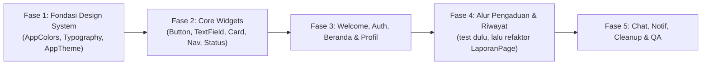

# SENTRA Mobile — UI/UX Design System & Improvement Plan

> **Versi Dokumen**: 2.0  
> **Aplikasi**: SENTRA (Aplikasi Pengaduan by DPPPA Nganjuk)  
> **Platform**: Flutter (Android & iOS) — Fokus **Light Mode**  
> **Arah Visual**: Gradasi hijau–biru dipertahankan sebagai identitas di **Splash & Welcome**. Seluruh layar lain memakai latar terang `#F6F7F5`, kartu putih ber-border halus, dan aksen warna per layanan. Kartu layanan di Beranda tetap berwarna penuh, dengan warna yang diperdalam agar teks putih lulus WCAG AA.

> **Perubahan dari v1.0**: (1) angka kontras kini dihitung dengan rumus WCAG, bukan diperkirakan, dan beberapa warna v1.0 diganti karena gagal; (2) gradasi brand dipertahankan; (3) navbar menjadi 4 item; (4) komponen yang belum dibutuhkan dikeluarkan; (5) hal yang belum pasti dipisahkan ke Bagian 9.

---

## 1. Visi Desain & Prinsip UX

Aplikasi SENTRA melayani masyarakat dalam situasi sensitif dan sering kali mendesak (pengaduan kekerasan perempuan/anak, bencana alam, rehabilitasi & permasalahan sosial). Seluruh keputusan UI/UX berpegang pada 4 prinsip berikut:

1. **Tenang & Tepercaya**
   - Latar terang `#F6F7F5` dan kartu putih `#FFFFFF`. Gradasi hanya di Splash dan Welcome.
   - Tanpa bayangan pekat, tanpa tombol bersudut asimetris.
2. **Beban Kognitif Rendah**
   - Form panjang (`LaporanPage`) dipecah per langkah, dengan indikator progres dan satu aksi utama tetap di bawah.
   - Akses pelaporan cepat tidak terhalang animasi panjang (intro maksimal 2 detik).
3. **Identitas Layanan Konsisten**
   - Setiap layanan punya satu warna dari Beranda hingga form:
     - **PPPA / SENTRA**: Hijau tua `#1F5C42`
     - **PJSRK**: Oranye tua `#A84F0F`
     - **PSK**: Indigo `#4856A6`
4. **Aksesibel & Responsif**
   - Target sentuh minimal **48×48 dp**, umpan balik sentuh (ripple + `HapticFeedback`), kontras teks minimal **4,5:1**, bahasa antarmuka **100% Bahasa Indonesia**, aman terhadap `TextScaler` 1,3x dan *keyboard inset*.

---

## 2. Audit UI Saat Ini & Pemetaan Masalah

Audit terhadap codebase dan screenshot (Welcome dan Beranda):

| Area / File | Temuan Masalah | Dampak UX | Prioritas |
| :--- | :--- | :--- | :---: |
| `lib/main.dart` | `ThemeData` hanya mengatur `fontFamily: 'Mulish'` tanpa `ColorScheme`, `TextTheme`, atau tema komponen. | Gaya widget diulang manual di setiap layar; rawan inkonsistensi. | **Tinggi** |
| `lib/core/utils/app_colors.dart` | Nama warna non-semantik (`backgroundijotuek`, `birunom`, `kuningtuek`, `oren`) dan bug `Color.fromRGBO(..., 100)` (opasitas valid 0.0–1.0). | Sulit dipelihara; warna tombol berpotensi tidak sesuai niat. | **Tinggi** |
| `lib/features/pjsrk/views/widgets/pjsrk_colors.dart` | Palet terpisah dari `core`; banyak hex hardcoded di layar lain. | Warna status dan surface tidak seragam antar fitur. | **Tinggi** |
| `lib/core/utils/custom_button.dart` | Sudut diagonal asimetris (`topLeft: 20, bottomRight: 20`), `GestureDetector` tanpa ripple, bayangan hitam pekat (opacity 0.25). | Terasa tidak responsif dan beda gaya dengan Beranda dan PJSRK. | **Tinggi** |
| `lib/core/utils/custom_text_field.dart` | `labelStyle` 20 px dengan `contentPadding` vertikal 5 px. | Input sempit, proporsi label tidak seimbang. | **Tinggi** |
| `lib/core/utils/custom_snackbar.dart` | Margin dihitung dengan `MediaQuery.size.height - tinggi!`. | Rentan overflow atau terpotong saat keyboard aktif / layar kecil. | **Tinggi** |
| Navigasi Bawah (4 versi) | `core/utils/navbar.dart`, `HomeScreen._BottomNavBar`, `PjsrkBottomNav`, `LaporanSayaBottomNav`. | Pengalaman navigasi berbeda antar modul. | **Tinggi** |
| Navbar di Beranda (screenshot) | Hanya 2 item (Beranda, Profil), padahal sudah ada layar riwayat dan chat konsultasi. Ikon dan label non-aktif pucat, bar putih bertemu kartu tanpa pemisah. | Fitur utama tidak punya jalan masuk dari navigasi. | **Tinggi** |
| Beranda (screenshot) | Tiga kartu warna jenuh dengan bobot sama, tidak ada titik fokus. Chip semi-transparan dan teks putih di atas oranye `#D6762C` (3,24:1) tidak lulus AA. | Sulit dibaca, terasa ramai walau isinya sedikit. | **Tinggi** |
| Welcome (screenshot) | Tombol pastel krem/mint di atas gradasi gelap, teks hijau/cokelat di atasnya, sudut diagonal, label "Get Started" berbahasa Inggris. Bagian tengah gradasi tampak abu-hijau. | Tombol terlihat tempelan dan kontras rendah. | **Tinggi** |
| `lib/features/report/views/report_screen.dart` | File monolitik **3.343 baris**; form panjang dalam satu alur. | Pengguna mudah lelah; sulit dirawat dan berisiko saat direfaktor. | **Tinggi** |
| `lib/features/welcome/welcome_screen.dart` | Animasi intro 6 detik + audio otomatis (`welcome.mp3`) tanpa tombol skip/mute yang menonjol. | Menghambat pengguna yang ingin segera melapor. | **Sedang** |
| `lib/features/auth/views/login_screen.dart` | `MediaQuery.textScaleFactor` (deprecated), tombol diagonal, label Inggris (*"Sign in"*, *"Sign up"*). | Tampilan auth tertinggal; berpotensi bermasalah di Flutter terbaru. | **Sedang** |
| `lib/features/auth/views/profile_screen.dart` & `history_screen.dart` | Header gradasi hijau–biru berat (`backgroundIjo` → `backgroundBiru`); empty state polos (*"No reports available"*). | Tidak selaras dengan Beranda. | **Sedang** |
| `lib/features/dashboard/views/dashboard_screen.dart` | Latar `LinearGradient` 4 warna putih semua; kartu informasi dan grafik memakai bayangan keras (`Colors.black12`). | Redundan dan kurang hierarki visual. | **Sedang** |
| `lib/features/pjsrk/views/widgets/` | Duplikasi file typo: `pjrsk_check_row.dart` vs `pjsrk_check_row.dart`, `pjrsk_summary_card.dart` vs `pjsrk_summary_card.dart`. | Risiko mengedit file yang salah. | **Rendah** |

---

## 3. Design System & Token Terpusat (`lib/core/theme/`)

Seluruh token dipusatkan di folder baru `lib/core/theme/`:
- `lib/core/theme/app_colors.dart` — Token warna semantik, gradasi brand, palet layanan
- `lib/core/theme/app_typography.dart` — Skala tipografi `Mulish`
- `lib/core/theme/app_spacing.dart` — Spacing, radius, elevasi
- `lib/core/theme/app_theme.dart` — `ThemeData` terpusat untuk `MaterialApp`

> Semua rasio kontras di bagian ini dihitung dengan rumus WCAG 2.x. Ambang: 4,5:1 untuk teks biasa, 3:1 untuk teks besar (18 sp ke atas, atau 14 sp tebal) dan ikon.

### 3.1 Color Tokens

#### A. Gradasi Brand (khusus Splash & Welcome)
| Posisi | Hex | Putih di atasnya |
| :--- | :--- | :---: |
| 0% (atas) | `#277F55` | 4,94:1 |
| 50% | `#1F6F6B` | 5,92:1 |
| 100% (bawah) | `#2F4C8C` | 8,29:1 |

- Arah: atas ke bawah. Nilai lama `#2F8F5B` hanya 4,04:1, sehingga digelapkan.
- Teks utama di atas gradasi: putih penuh. Teks sekunder: putih 90% (5,16:1 di tengah, 7,07:1 di bawah), **tidak dipakai di zona atas** (4,33:1).
- Putih 70% tidak boleh dipakai untuk teks (2,79:1 sampai 3,81:1).

#### B. Brand & Surface (Light Mode)
| Token | Hex | Kontras terukur | Kegunaan |
| :--- | :--- | :--- | :--- |
| `AppColors.primary` | `#1F5C42` | putih di atasnya 7,87:1 | Tombol utama, tab aktif, focus border |
| `AppColors.primarySoft` | `#E8F1EC` | `primary` di atasnya 6,83:1 | Pill navbar aktif, latar ikon |
| `AppColors.background` | `#F6F7F5` | | Latar `Scaffold` |
| `AppColors.surface` | `#FFFFFF` | | Kartu, sheet, dialog, input |
| `AppColors.surfaceVariant` | `#F1F4F2` | | Chip non-aktif, input read-only, search bar |
| `AppColors.border` | `#E5E9EF` | | Tepi kartu, divider, border input |
| `AppColors.textPrimary` | `#16231D` | 15,12:1 di `background` | Judul, isi utama |
| `AppColors.textSecondary` | `#4F5F57` | 6,76:1 putih / 6,29:1 `background` | Subjudul, deskripsi, metadata |
| `AppColors.textMuted` | `#5F6E67` | 5,37:1 putih / 4,99:1 `background` | Hint, placeholder, tanggal. (Nilai v1.0 `#94A3B8` hanya 2,56:1) |

#### C. Service Identity Palette
Dipakai sebagai latar kartu layanan penuh dan aksen modul (tombol, chip, ikon) di dalam modul tersebut.

| Layanan | Latar kartu | Putih di atasnya | Soft Tint | Teks/ikon pada tint |
| :--- | :--- | :---: | :--- | :--- |
| **PPPA / SENTRA** | `#1F5C42` | 7,87:1 | `#E8F1EC` | `#1F5C42` = 6,83:1 |
| **PJSRK** | `#A84F0F` | 5,54:1 | `#FCEBDC` | `#A84F0F` = 4,76:1 |
| **PSK** | `#4856A6` | 6,65:1 | `#EEF0FA` | `#4856A6` = 5,85:1 |

Nilai v1.0 yang diganti: PJSRK `#D6762C` (putih hanya 3,24:1) dan `#B85A14` (pada tint hanya 4,00:1). PSK berstatus "Segera Hadir" dirender redup (opasitas 55%) dan dikecualikan dari target kontras karena komponen nonaktif.

#### D. Semantic & Status Laporan
| Status | Foreground | Background Soft | Kontras | Ikon |
| :--- | :--- | :--- | :---: | :--- |
| **Terkirim** | `#B45309` | `#FEF3C7` | 4,51:1 | `Icons.send_rounded` |
| **Diterima** | `#1D4ED8` | `#DBEAFE` | 5,49:1 | `Icons.inbox_rounded` |
| **Diproses** | `#C2410C` | `#FFEDD5` | 4,52:1 | `Icons.autorenew_rounded` |
| **Selesai** | `#15803D` | `#DCFCE7` | 4,57:1 | `Icons.check_circle_rounded` |
| **Ditolak** | `#B42318` | `#FEE2E2` | 5,38:1 | `Icons.cancel_outlined` |

Terkirim, Diproses, dan Selesai hanya lolos tipis: jangan dipakai di bawah 11 sp. Status selalu memakai ikon dan teks, tidak hanya warna.

### 3.2 Typography Scale (`Mulish`)

> Pastikan bobot `400`, `500`, `600`, `700`, `800` tersedia di `assets/font/` dan terdaftar di `pubspec.yaml` agar tidak terjadi *faux bold*.

| Style Name | Size | Weight | Line Height | Kegunaan |
| :--- | :---: | :---: | :---: | :--- |
| `display` | 28 sp | 800 | 1.25 | Nama "SENTRA" di Welcome |
| `title` | 20 sp | 700 | 1.30 | Judul halaman |
| `subtitle` | 16 sp | 700 | 1.40 | Judul kartu, judul seksi |
| `body` | 14 sp | 400 | 1.50 | Isi umum, input, chat bubble |
| `bodyStrong` | 14 sp | 700 | 1.40 | Label tombol, judul item list |
| `caption` | 12 sp | 500 | 1.45 | Deskripsi kartu, tanggal, helper text |
| `label` | 11 sp | 700 | 1.20 | Badge, label navbar, label seksi kapital (`letterSpacing: 0.8`) |

### 3.3 Spacing, Border Radius & Elevation

- **Spacing Grid (kelipatan 4 dp)**: `xs = 4`, `sm = 8`, `md = 12`, `lg = 16`, `xl = 20`, `xxl = 24`, `section = 32`.
- **Padding Halaman Standar**: horizontal `16` (`24` untuk Welcome dan auth).
- **Border Radius**:
  - `radiusSm = 8` (badge, tag kecil)
  - `radiusMd = 12` (tombol, input, snackbar)
  - `radiusLg = 16` (kartu konten, item riwayat, bubble chat)
  - `radiusXl = 24` (kartu layanan, dialog, bottom sheet)
  - `radiusPill = 999` (chip, avatar, indikator navbar)
- **Elevation**:
  - Kartu putih: border `1px #E5E9EF`, **tanpa bayangan**.
  - Navbar: garis atas `1px #E5E9EF`, tanpa bayangan.
  - Bayangan hanya untuk dialog dan bottom sheet.

### 3.4 Blueprint `AppTheme` (`lib/core/theme/app_theme.dart`)

```dart
ThemeData buildSentraTheme() {
  const colorScheme = ColorScheme.light(
    primary: Color(0xFF1F5C42),
    onPrimary: Colors.white,
    surface: Colors.white,
    onSurface: Color(0xFF16231D),
    error: Color(0xFFB42318),
    onError: Colors.white,
    outline: Color(0xFFE5E9EF),
  );

  return ThemeData(
    useMaterial3: true,
    fontFamily: 'Mulish',
    colorScheme: colorScheme,
    scaffoldBackgroundColor: const Color(0xFFF6F7F5),
    appBarTheme: const AppBarTheme(
      backgroundColor: Colors.white,
      foregroundColor: Color(0xFF16231D),
      elevation: 0,
      scrolledUnderElevation: 1,
      centerTitle: false,
    ),
    cardTheme: CardThemeData(
      color: Colors.white,
      elevation: 0,
      shape: RoundedRectangleBorder(
        borderRadius: BorderRadius.circular(16),
        side: const BorderSide(color: Color(0xFFE5E9EF)),
      ),
    ),
    inputDecorationTheme: InputDecorationTheme(
      filled: true,
      fillColor: Colors.white,
      contentPadding: const EdgeInsets.symmetric(horizontal: 14, vertical: 14),
      hintStyle: const TextStyle(color: Color(0xFF5F6E67)),
      border: OutlineInputBorder(
        borderRadius: BorderRadius.circular(12),
        borderSide: const BorderSide(color: Color(0xFFE5E9EF)),
      ),
      enabledBorder: OutlineInputBorder(
        borderRadius: BorderRadius.circular(12),
        borderSide: const BorderSide(color: Color(0xFFE5E9EF)),
      ),
      focusedBorder: OutlineInputBorder(
        borderRadius: BorderRadius.circular(12),
        borderSide: const BorderSide(color: Color(0xFF1F5C42), width: 1.6),
      ),
      errorBorder: OutlineInputBorder(
        borderRadius: BorderRadius.circular(12),
        borderSide: const BorderSide(color: Color(0xFFB42318)),
      ),
    ),
    elevatedButtonTheme: ElevatedButtonThemeData(
      style: ElevatedButton.styleFrom(
        backgroundColor: const Color(0xFF1F5C42),
        foregroundColor: Colors.white,
        minimumSize: const Size(double.infinity, 52),
        elevation: 0,
        shape: RoundedRectangleBorder(borderRadius: BorderRadius.circular(12)),
      ),
    ),
  );
}

// app_colors.dart (gradasi brand)
const brandGradient = LinearGradient(
  begin: Alignment.topCenter,
  end: Alignment.bottomCenter,
  colors: [Color(0xFF277F55), Color(0xFF1F6F6B), Color(0xFF2F4C8C)],
  stops: [0.0, 0.5, 1.0],
);
```

---

## 4. Konsolidasi Komponen UI (`lib/core/widgets/`)

| Komponen Baru | Menggantikan | Spesifikasi Utama |
| :--- | :--- | :--- |
| `SentraButton` | `CustomRoundedButton`, tombol manual di `login_screen.dart`, `pjsrk_gradient_button.dart` | Tinggi 52, radius `12` simetris. Varian: `primary`, `outlined`, `danger`, `onGradient` (isi putih, teks `primary`), `onGradientOutlined` (garis putih 1,5 px). Berbasis `ElevatedButton`/`OutlinedButton` (ripple + disabled state). `isLoading` menonaktifkan tombol. Parameter `accentColor` untuk modul PJSRK/PSK. |
| `SentraTextField` | `CustomTextField`, `pjsrk_text_box.dart`, `pjsrk_text_field.dart`, `pppa_text_field.dart` | Label di atas field (`13px w700`), hint `14px #5F6E67`, padding vertikal `14`, radius `12`, ikon awal/akhir, pesan error di bawah field. |
| `SentraCard` | Container berulang di `dashboard`, `history`, `pjsrk`, `profile` | Putih, border `1px #E5E9EF`, radius `16`, tanpa bayangan, varian `InkWell` untuk kartu interaktif. |
| `SentraBottomNav` | `core/utils/navbar.dart`, `HomeScreen._BottomNavBar`, `PjsrkBottomNav`, `LaporanSayaBottomNav` | Satu komponen: 4 item, pill indikator `primarySoft`, `activeColor` bisa diatur per modul. Detail di Bagian 5.2. |
| `SentraStatusBadge` | Logika warna/ikon status berulang di `history`, `pjsrk_tracking_card`, `notification` | Satu pemetaan status ke pill berwarna + ikon (tabel 3.1.D). |
| `SentraEmptyState` | Teks polos `"No reports available"` | Ikon dalam lingkaran soft tint, judul, satu kalimat, satu tombol aksi. Bahasa Indonesia. |

Snackbar memakai `ScaffoldMessenger` + `SnackBar(behavior: SnackBarBehavior.floating)` bawaan Material. `CustomSnackbar` lama dihapus.

**Tidak dibuat sampai ada kebutuhan nyata**: `SentraAppBar` (pakai `AppBar` + `appBarTheme`), `SentraStepper` (buat khusus di alur laporan), `SentraErrorState` (cukup varian `SentraEmptyState`).

### Pembersihan File Duplikat / Legacy
Setelah konsolidasi selesai:
- Hapus file typo di `lib/features/pjsrk/views/widgets/`: `pjrsk_check_row.dart`, `pjrsk_summary_card.dart`, `pjrsk_font_scope.dart` (cek referensi import dulu).
- Pensiunkan `lib/core/utils/navbar.dart` jika tidak dipakai.
- Hapus script bantu sementara di root jika tidak diperlukan (`tool_edit_login.js`, `pjsrk_out.txt`).

---

## 5. Spesifikasi Redesign per Layar

### 5.1 Onboarding & Autentikasi

#### 1. `SplashScreen` & `WelcomeWithSplashScreen`
- **Masalah**: tombol pastel dan diagonal, "Get Started" berbahasa Inggris, gradasi tengah kusam, intro 6 detik, audio otomatis, file 1.359 baris mencampur welcome dengan form.
- **Perbaikan**:
  - Latar `brandGradient` (3.1.A). Logo di tengah, "SENTRA" (`display`, putih penuh), di bawahnya "Dinas Sosial dan PPA Kabupaten Nganjuk" (`caption`, putih 90%).
  - Intro **1,5–2,0 detik**, fade dan geser halus.
  - Audio `welcome.mp3` tidak diputar otomatis. Jadikan opsional dengan tombol suara yang terlihat di pojok kanan atas.
  - Dua tombol di bawah (margin samping 24, jarak 12):
    1. `SentraButton.onGradient` + ikon petir: **"Pelaporan Cepat"**
    2. `SentraButton.onGradientOutlined`: **"Masuk atau Daftar"**
  - Pisahkan modal/sheet form dari `welcome_screen.dart`.

#### 2. `LoginPage` & `GantiNomorScreen`
- **Masalah**: sudut tombol diagonal, label Inggris, `MediaQuery.textScaleFactor`, jarak field bergantung persentase `screenHeight`.
- **Perbaikan**:
  - Segmented control **Masuk | Daftar** berlatar `surfaceVariant` dengan pill putih aktif.
  - `SentraTextField` dan `SentraButton`. Spacing tetap: `16` antar field, `24` antar seksi.
  - Ganti `textScaleFactor` dengan `MediaQuery.textScalerOf(context)`.
  - Seluruh teks Bahasa Indonesia (*"Masuk"*, *"Daftar"*, *"Lupa / Ganti Nomor?"*).

---

### 5.2 Beranda & Navigasi Utama

#### 3. `HomeScreen` & `BerandaScreen`
- **Masalah**: bobot tiga kartu sama, kontras chip dan teks di atas oranye, navbar 2 item.
- **Perbaikan**:
  - Header: latar `background`, logo kecil, "SENTRA" dan "Dinas Sosial dan PPA", lonceng dengan titik merah jika ada notifikasi belum dibaca. Tinggi sekitar 64 dp.
  - Kartu layanan urut **PPPA, PJSRK, PSK**. PPPA dan PJSRK tinggi sama (sekitar 150 dp), PSK lebih pendek (sekitar 110 dp, redup, label "Segera Hadir", tidak bisa ditekan).
  - Isi kartu: kotak ikon 40 dp berlatar putih 16%, judul (`subtitle`, putih), deskripsi (`caption`, putih), chip sub-layanan **berlatar putih solid dengan teks warna layanan** (menggantikan chip semi-transparan), chevron putih.
  - Ilustrasi di kanan dipertahankan, tetapi jangan menurunkan kontras teks. Jika tidak terbaca di ukuran kecil, buang.
  - Semua warna dari `AppColors` / `ServicePalette`, tidak ada hex hardcoded.
  - Blok "Laporan terakhir saya" (nomor tiket, badge status, tanggal) dan "Informasi terkini" hanya dibuat **jika datanya tersedia dari API**, bukan placeholder.

#### Navbar (`SentraBottomNav`)

| Slot | Label | Layar |
| :--- | :--- | :--- |
| 1 | Beranda | `HomeScreen` |
| 2 | Laporan | `history_screen.dart` |
| 3 | Konsultasi | `ChatKonsultasiScreen` |
| 4 | Profil | `ProfileScreen` |

- Tinggi 64 dp + safe area. Latar putih, garis atas `1px #E5E9EF`.
- Item aktif: pill `primarySoft`, ikon dan label `primary`, label bobot 700. Item non-aktif: ikon dan label `textSecondary`.
- Label selalu tampil (11 sp). Target sentuh minimal 48×48 dp.
- Padding bawah konten halaman setinggi navbar agar tidak tertutup.
- `HapticFeedback.lightImpact()` saat pindah tab. Transisi pill 200 ms.
- **Usulan (belum diputuskan, lihat Bagian 9)**: tombol "Lapor" bulat di tengah, sehingga slot menjadi Beranda, Laporan, **Lapor**, Konsultasi, Profil.

---

### 5.3 Modul PPPA & Dashboard

#### 4. `PppaScreen` & `DashboardScreen`
- **Masalah**: `LinearGradient` 4 warna putih yang tidak perlu, kartu grafik dan informasi memakai bayangan lama, `DashboardScreen` dan `PppaScreen` belum menyatu.
- **Perbaikan**:
  - Hapus `LinearGradient` putih; gunakan `backgroundColor: AppColors.background`.
  - Bungkus **Tracking Laporan**, **Statistik Laporan Kekerasan**, dan **Informasi Terkini** dalam `SentraCard` dengan header seksi seragam (judul + aksi "Lihat Semua" bila relevan).
  - Shimmer loading mengikuti bentuk kartu (radius `16`, warna `#E2E8F0` ke `#F8FAFC`).
  - Pakai `SentraBottomNav`.

---

### 5.4 Modul PJSRK

#### 5. `PjsrkScreen`, Form PJSRK & `pjsrk_riwayat.dart`
- **Status Saat Ini**: `PjsrkScreen` dan `PjsrkTrackingCard` sudah rapi.
- **Perbaikan**:
  - Migrasikan `PjsrkColors` ke `ServicePalette.pjsrk` (nilai baru `#A84F0F`).
  - Form 3 langkah (Kejadian → Lokasi → Kirim), `RehabilitasiSosialFormScreen`, dan `PermasalahanSosialScreen` memakai `SentraTextField` dan `SentraButton(accentColor: ServicePalette.pjsrk.primary)`.
  - `pjsrk_riwayat.dart` dan `pjsrk_detail_laporan.dart` memakai `SentraStatusBadge` dan `SentraEmptyState`.

---

### 5.5 Modul Pelaporan & Riwayat

#### 6. `PelaporanCepatMenuScreen`
- Ganti warna hardcoded `Color.fromARGB(255, 46, 132, 93)` dengan `AppColors.primary`.
- Transisi accordion pada `CardPjsrk`: `AnimatedSize` + rotasi chevron.
- Tambahkan micro-copy singkat tentang perkiraan waktu pengisian **setelah diukur** pada alur sebenarnya (v1.0 menyebut sekitar 2 menit tanpa pengukuran).

#### 7. `LaporanPage` (`report_screen.dart`, 3.343 baris)
- **Masalah**: form multi-step sangat panjang dalam satu file; beban visual tinggi.
- **Perbaikan**:
  - **Test lebih dulu**: tambahkan test untuk validasi dan pengiriman form sebelum dipecah, agar refaktor bisa diverifikasi.
  - **Modularisasi**: sub-widget per langkah (`StepDataPelapor`, `StepKronologi`, `StepWaktuLokasi`) di `lib/features/report/views/widgets/`.
  - **Indikator langkah** di atas (`1. Data Pihak` → `2. Kronologi` → `3. Waktu & Lokasi`), selalu terlihat.
  - **Blok opsional** (*Terlapor*, *Informasi Anak*) dalam `SentraCard` terpisah dengan toggle.
  - **Bar aksi tetap** di bawah (`SafeArea`): `Kembali` (outlined) dan `Lanjut / Kirim Laporan` (primary).
  - **Draf tersimpan otomatis** secara lokal agar laporan panjang tidak hilang saat aplikasi tertutup.

#### 8. `HistoryPage` (`history_screen.dart`, 1.521 baris)
- **Masalah**: AppBar gradasi lama, empty state Inggris, kartu item kurang hierarkis.
- **Perbaikan**:
  - `AppBar` putih dengan `appBarTheme` (bukan gradasi).
  - Chip filter yang bisa digeser: `Semua`, `Terkirim`, `Diterima`, `Diproses`, `Selesai`, plus search bar radius `12`.
  - Kartu item (`_buildReportTile`) memakai `SentraCard`:
    - Baris atas: nomor/kategori laporan + `SentraStatusBadge` di kanan.
    - Baris tengah: ringkasan maksimal 2 baris, ellipsis.
    - Baris bawah: ikon kalender, tanggal, jenis layanan (`textSecondary`).
  - Halaman detail: linimasa status vertikal (Terkirim → Diterima → Diproses → Selesai) dengan tanggal dan jam, serta nomor tiket yang bisa disalin.
  - Empty state: `SentraEmptyState` ("Belum ada laporan. Laporan yang Anda kirim akan muncul di sini.").

---

### 5.6 Chat, Notifikasi & Profil

#### 9. `ChatKonsultasiScreen` & `RoomChat`
- Header: avatar petugas dengan indikator online, nama, subjudul *"Layanan Konsultasi SENTRA"*.
- Bubble pengguna di kanan (`primary`, teks putih, radius 16, sudut bawah-kanan 4). Bubble petugas di kiri (putih, border `border`, teks `textPrimary`, sudut bawah-kiri 4).
- Pemisah tanggal berupa pill (`Hari ini`, `Kemarin`) berlatar `#E2E8F0`.
- Input bar: container putih, input melengkung (`maxLines: 4`), tombol kirim bulat `44×44 dp`, `SafeArea`.

#### 10. `NotificationPage`
- Hapus `BackdropFilter(sigmaX: 1, sigmaY: 1)` yang dampak visualnya kecil tetapi menambah beban render.
- Belum dibaca: latar `#F0FAF4`, titik hijau kecil, judul `w700`. Sudah dibaca: latar putih, judul `w600`.
- Warna dan ikon status dari `SentraStatusBadge`.
- Aksi *"Tandai semua dibaca"* di AppBar.

#### 11. `ProfileScreen`
- **Masalah**: header gradasi berat, tombol logout bersaing dengan judul, dialog logout default.
- **Perbaikan**:
  - Header solid `primary` (putih di atasnya 7,87:1), avatar inisial ber-ring putih, nama lengkap, nomor telepon.
  - Informasi akun dalam `SentraCard` ("Informasi Pribadi") dengan mode baca vs edit yang jelas.
  - Tombol **Keluar** dipindah ke bawah sebagai `SentraButton` varian `danger` (outlined, `#B42318`).
  - Dialog konfirmasi logout bergaya dialog modern di `BerandaScreen` (`_showComingSoonDialog`): radius 24, ikon container, tombol penuh.
  - Bagian "Tentang": kontak resmi, jam layanan, alamat kantor, versi aplikasi (isi diambil dari dinas, lihat Bagian 9).

---

## 6. Micro-interactions, Motion & Aksesibilitas

1. **Durasi Animasi Standar**:
   - Micro-state (chip, tab, switch): `150–200 ms` (`Curves.easeOutCubic`)
   - Transisi konten / `AnimatedSwitcher`: `250 ms`
   - Accordion / expandable card: `250–300 ms` (`Curves.easeInOutCubic`)
   - Intro Welcome: `1,5–2,0 s`
2. **Haptic Feedback**:
   - `HapticFeedback.lightImpact()` pada pindah tab, pilih chip, toggle switch.
   - `HapticFeedback.mediumImpact()` pada laporan terkirim.
3. **Aksesibilitas & Responsivitas**:
   - Target sentuh minimal **48×48 dp** untuk semua tombol, ikon header, dan item list.
   - Pakai `MediaQuery.textScalerOf(context)`; teks tidak terpotong pada skala `1.3x`.
   - Pakai `Color.withValues(alpha: ...)`, bukan `withOpacity` (deprecated di Flutter 3.27+).
   - Tambahkan `Semantics` pada kartu layanan, badge status, ikon tombol, dan item navbar. Uji dengan TalkBack dan VoiceOver.
   - `ConstrainedBox(maxWidth: 640)` pada layar konten utama (mengikuti pola `PjsrkScreen`).
4. **Teks antarmuka** (draf, harus disetujui petugas dinas):

| Sekarang | Ganti dengan |
| :--- | :--- |
| Get Started | dihapus (Welcome memakai "Pelaporan Cepat" dan "Masuk atau Daftar") |
| Sign in / Sign up | Masuk / Daftar |
| No reports available | Belum ada laporan. Laporan yang Anda kirim akan muncul di sini. |
| Pesan error umum | Laporan belum terkirim. Periksa sambungan internet, lalu coba lagi. |

---

## 7. Roadmap Implementasi Bertahap

Implementasi inkremental agar setiap perubahan mudah diuji, tidak merusak fitur yang berjalan, dan minim konflik Git.



> Estimasi di bawah adalah perkiraan awal dan belum divalidasi terhadap kode. Fase 4 kemungkinan paling meleset karena menyangkut file 3.343 baris.

### Detail Fase & Deliverables

- **Fase 1 — Fondasi Design System (Estimasi: 1–2 hari)**
  - Buat `app_colors.dart`, `app_typography.dart`, `app_spacing.dart`, `app_theme.dart`.
  - Daftarkan semua bobot `Mulish` di `pubspec.yaml`.
  - Pasang `buildSentraTheme()` di `lib/main.dart`.
  - Perbaiki bug `Color.fromRGBO(..., 100)` atau jadikan jembatan sementara yang diberi tanggal penghapusan.

- **Fase 2 — Pustaka Komponen Inti (Estimasi: 2–3 hari)**
  - Buat `SentraButton`, `SentraTextField`, `SentraCard`, `SentraBottomNav`, `SentraStatusBadge`, `SentraEmptyState`.
  - Widget test dasar untuk tiap komponen, termasuk tombol (state loading dan nonaktif) dan navbar (4 item).

- **Fase 3 — Welcome, Auth, Beranda & Profil (Estimasi: 2–3 hari)**
  - Refactor `WelcomeWithSplashScreen`, `LoginPage`, `GantiNomorScreen`, `ProfileScreen`.
  - Beranda: kartu layanan baru, navbar 4 item, token warna.

- **Fase 4 — Alur Pengaduan, PPPA, PJSRK & Riwayat (Estimasi: 5–8 hari)**
  - **Langkah pertama**: test untuk validasi dan pengiriman `LaporanPage`.
  - Pecah dan redesign `LaporanPage`, tambahkan draf otomatis.
  - Redesign `HistoryPage` (+ linimasa status) dan `DashboardScreen`.
  - Migrasikan `PjsrkColors` dan komponen form di `pjsrk/` dan `pppa/`.

- **Fase 5 — Chat, Notifikasi, Pembersihan & QA Visual (Estimasi: 2–3 hari)**
  - Redesign `ChatKonsultasiScreen`, `RoomChat`, `NotificationPage`.
  - Hapus file duplikat (`pjrsk_*`, `navbar.dart` lama).
  - Uji di 360×640, 390×844, 430×932, dan skala font 1,3x.

---

## 8. Checklist Verifikasi QA UI

Sebelum setiap fase dinyatakan selesai:
- [ ] `flutter analyze` bebas error dan tidak menambah warning baru.
- [ ] `flutter test` seluruh unit dan widget test lulus.
- [ ] Tidak ada *RenderFlex overflow* pada lebar 360 dp maupun saat keyboard terbuka.
- [ ] Seluruh label, tombol, empty state, dan pesan error berbahasa Indonesia.
- [ ] Pasangan teks/latar pada hasil render akhir dicek ulang dengan alat kontras (terutama teks di atas ilustrasi kartu).
- [ ] Status bar icon brightness sesuai warna header di tiap layar.
- [ ] Semua tombol utama punya efek sentuh (ripple) dan loading state yang mencegah ketukan ganda.
- [ ] Hanya satu implementasi navbar yang tersisa.
- [ ] Pembaca layar membaca kartu layanan, badge status, dan item navbar dengan benar.

---

## 9. Keputusan Terbuka & Hal yang Belum Diverifikasi

| Hal | Status | Penentu |
| :--- | :--- | :--- |
| Nomor hotline untuk bantuan segera | Belum ada. Jangan dipasang tanpa konfirmasi | Dinas |
| Batas waktu respons petugas | Belum ada data. Jangan dijanjikan di antarmuka | Dinas |
| Pedoman identitas visual Pemkab/Dinas (logo, warna wajib) | Belum dilihat. Jika ada, warna di dokumen ini harus menyesuaikan | Dinas |
| Isi bagian "Tentang" (kontak, jam layanan, alamat) | Belum ada | Dinas |
| Tombol "Lapor" di tengah navbar | Usulan, belum diuji ke pengguna | Tim produk |
| Ilustrasi di kartu layanan: tetap atau dibuang | Perlu dilihat di perangkat nyata | Desainer |
| Cakupan tablet atau Flutter Web | Belum ditentukan. Jika ada, navbar bawah perlu diganti navigasi samping di layar lebar | Tim produk |
| Fitur tombol keluar cepat atau penyamaran layar untuk pelapor sensitif | Belum dirancang. Sebaiknya dibahas dengan petugas yang menangani korban | Dinas & tim produk |
| Estimasi hari per fase | Belum divalidasi terhadap kode | Tim pengembang |