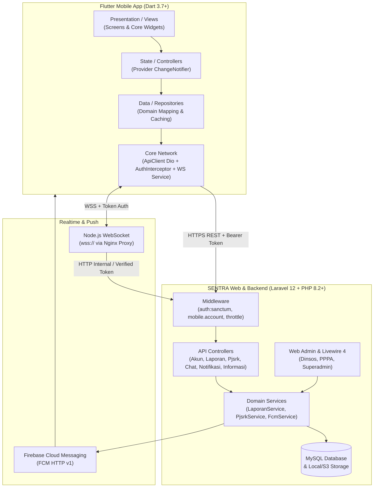

# SENTRA — System & Code Architecture Blueprint

> **Versi**: 1.0  
> **Lingkup**: Flutter Mobile (`C:\Projects\keloompok3C-Sentra-`) ↔ Laravel Web & API (`C:\Projects\Sentra`) + Node.js WebSocket (`websocket-server.cjs`)  
> **Tujuan**: Menjadikan codebase rapi, terstruktur, mudah diuji (*testable*), dan *scalable* tanpa duplikasi logika maupun ketergantungan lintas layer.

---

## 1. Arsitektur Sistem End-to-End



---

## 2. Baseline Stack Saat Ini

| Komponen | Lokasi | Stack Terdeteksi | Catatan Baseline |
| :--- | :--- | :--- | :--- |
| **Mobile** | `C:\Projects\keloompok3C-Sentra-` | Flutter / Dart `^3.7.0`, `dio`, `provider`, `get` (legacy), `web_socket_channel`, `firebase_messaging`, `geolocator`, `flutter_map` | Masih mencampur `Provider` + `GetX` + `rxdart` + `setState` langsung. |
| **Web & API** | `C:\Projects\Sentra` | PHP `^8.2`, Laravel `^12.0`, Sanctum `^4.1`, Livewire `^4.4`, Yajra DataTables | Ada 2 controller auth (`AkunControllerMobile` & `AuthControllerMobile`) dan beberapa endpoint publik non-Sanctum. |
| **WebSocket** | `C:\Projects\Sentra\websocket-server.cjs` | Node.js `ws ^8.21.3`, `mysql ^2.18.1` | Menulis langsung ke MySQL tanpa autentikasi token dan tidak memicu FCM. |

---

## 3. Standar Arsitektur Flutter (*Feature-First Clean Architecture*)

Setiap fitur di `lib/features/<feature>/` wajib mengikuti pembagian tanggung jawab yang tegas:

```text
lib/
├── core/
│   ├── config/          # EnvConfig (--dart-define), FeatureFlags
│   ├── network/         # ApiClient (SATU instance Dio), AuthInterceptor, Endpoints, ApiException
│   ├── theme/           # AppColors, AppTypography, AppSpacing, AppTheme
│   ├── widgets/         # SentraButton, SentraTextField, SentraCard, SentraCurvedHeader, dll.
│   └── utils/           # Validators, DateFormatter, PhotoUrlResolver (tanpa Dio/UI)
└── features/
    └── <feature>/
        ├── models/      # Immutable DTO + fromJson/toJson + unit test
        ├── repositories/# Satu-satunya layer yang memanggil ApiClient / local storage
        ├── controllers/ # ChangeNotifier (Provider) untuk state, loading, error, business flow
        └── views/       # Stateless/Stateful UI murni (DILARANG memanggil Dio/http/DB langsung)
            └── widgets/ # Sub-komponen layar (target < 300 baris per file)
```

### Aturan Keras (*Architectural Guardrails*)
1. **Satu Pintu Network (`ApiClient`)**:
   - **DILARANG** membuat `Dio()` baru atau mengimpor `package:http/http.dart` di luar `lib/core/network/`.
   - File yang wajib dimigrasi ke `ApiClient`:
     - `lib/features/auth/views/ganti_nomor_screen.dart` (4 pemanggilan `Dio()` langsung di UI!)
     - `lib/features/auth/repositories/otp_repository.dart`
     - `lib/features/notification/repositories/notif_repository.dart` (dan hapus duplikat `lib/features/notification/notif_repository.dart`)
     - `lib/core/utils/address_field.dart` (4 instance `Dio()`)
     - `lib/features/report/views/report_screen.dart` & `lib/features/pjsrk/views/widgets/pjsrk_map_preview.dart` (`package:http`)
2. **Satu State Management (`Provider`)**:
   - Standarkan seluruh state aplikasi pada **`Provider` (`ChangeNotifier`)** yang sudah menjadi tulang punggung `main.dart` (`UserProvider`, `ChatController`, `LoginController`, `RegisterController`, `GantiNomorController`).
   - **Pensiunkan `GetX` (`get`)**: Migrasikan `LaporanController` (`lib/features/report/controllers/report_controller.dart`) dari `GetxController` ke `ChangeNotifier` agar lifecycle provider konsisten, mudah di-mock saat unit test, dan mengurangi ukuran APK.
   - **Pensiunkan `rxdart` manual di `NotificationController`**: Ganti ke `ChangeNotifier` dengan `Timer`/polling terkendali atau push-triggered refresh + `dispose()` yang membatalkan semua subscription.
3. **Auth Interceptor & Auto-Logout Terpusat**:
   - Pasang `InterceptorsWrapper` di `ApiClient.dio` untuk:
     - Menyisipkan `Authorization: Bearer <token>` secara otomatis.
     - Menangani HTTP `401 Unauthorized` secara global: bersihkan `AuthSession`, reset state provider, dan arahkan ke `LoginPage` dengan pesan yang jelas.
   - Simpan token Sanctum di **`flutter_secure_storage`** (paket sudah ada di `pubspec.yaml`), bukan `SharedPreferences` plaintext.
4. **Dilarang Menelan Error (*No Silent Catch*)**:
   - Setiap `Controller` wajib memetakan kegagalan API menjadi state `errorMessage` yang ramah pengguna, bukan mengosongkan list diam-diam (seperti bug saat ini di `LaporanController.getUserReports`).
5. **Batas Ukuran File & Modularisasi**:
   - Target maksimal **300–400 baris per file UI**. File monolitik prioritas untuk dipecah:
     - `lib/features/report/views/report_screen.dart` (3.343 baris) → pecah menjadi `ReportFormController` + `StepDataPelapor`, `StepKronologi`, `StepWaktuLokasi`, `ReportPreviewSheet`.
     - `lib/features/auth/views/ganti_nomor_screen.dart` (2.163 baris) → pisahkan logic ke `GantiNomorController` & pecah layar OTP/Reset.
     - `lib/features/report/views/history_screen.dart` (1.521 baris) → pisahkan kartu & detail sheet ke `widgets/`.
     - `lib/features/pjsrk/views/permasalahan_sosial_screen.dart` (1.259 baris) → pindahkan logic upload multipart ke `PjsrkPermasalahanRepository`.
     - `lib/features/chat/views/chat_screen.dart` (1.234 baris) → pisahkan bubble, input bar, dan typing indicator ke `widgets/`.

---

## 4. Standar Arsitektur Backend Laravel (`C:\Projects\Sentra`)

1. **Satu Controller per Domain**:
   - Konsolidasikan `AuthControllerMobile.php` dan `AkunControllerMobile.php` menjadi satu gerbang autentikasi mobile terstandar agar tidak ada dua perilaku login/register berbeda (`/api/login` vs `/api/auth/login`).
2. **FormRequest & API Resource**:
   - Pindahkan aturan validasi panjang dari controller ke `app/Http/Requests/Mobile/*Request.php`.
   - Gunakan `app/Http/Resources/*Resource.php` untuk menstandarkan struktur JSON output (mencegah kebocoran kolom terenkripsi mentah `eyJpdiI6...` atau nama key inkonsisten seperti `Tempat_lahir`).
3. **Service Layer Bersama Web & Mobile**:
   - Logika pembuatan laporan, perubahan status, pengiriman notifikasi DB + FCM harus melalui satu `Service` (`LaporanWorkflowService`) agar aksi dari **Admin Web** maupun **Mobile** selalu menghasilkan status, log audit, dan notifikasi yang 100% identik.
4. **Satu Format Envelope Response JSON**:
   ```json
   {
     "success": true,
     "message": "Deskripsi singkat untuk pengguna",
     "data": {},
     "errors": null
   }
   ```
   - Pada error `500` di produksi (`APP_DEBUG=false`), **dilarang** mengembalikan `'error' => $e->getMessage()` ke klien (catat hanya ke `Log::error(...)`).
5. **WebSocket sebagai Transport, Bukan Bypass DB**:
   - `websocket-server.cjs` wajib memverifikasi token Sanctum saat handshake/register, memvalidasi kepemilikan `sender_id` pada `edit_message`/`delete_message`, dan menyelaraskan persistensi + trigger FCM dengan `ChatControllerMobile`.
