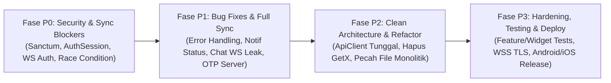

# SENTRA — Sync, Bug & Security Audit + Execution Roadmap

> **Tanggal Audit**: 2026-11-23  
> **Repositori Diaudit**: `C:\Projects\keloompok3C-Sentra-` (Flutter) & `C:\Projects\Sentra` (Laravel + WebSocket)  
> **Metode**: Inspeksi langsung pada controller API, routes, konfigurasi, WebSocket server, repositories, services, dan controllers Flutter.

---

## 1. Temuan Kritis — P0 (Blocker Keamanan & Sinkronisasi Wajib Sebelum Deploy)

| ID | Lokasi | Temuan Nyata di Kode | Risiko / Dampak | Solusi Target |
| :--- | :--- | :--- | :--- | :--- |
| **P0-01** | `Sentra\app\Http\Controllers\AkunControllerMobile.php` (`loginBiometric`, `loginWithEmail`) | `POST /api/auth/biometric` menerbitkan token Sanctum hanya dengan `notelp`; `POST /api/auth/email` hanya dengan `email` tanpa verifikasi password/token. | **Account Takeover penuh** — siapa pun yang tahu nomor HP/email bisa login ke akun korban. | Pindahkan validasi sesi `AuthSession.restore()` di Flutter ke `GET /api/user` dengan Bearer token. Wajibkan verifikasi Firebase/Google ID Token untuk login email, atau nonaktifkan endpoint tidak aman. |
| **P0-02** | `Sentra\routes\api.php` (baris 36, 51–72) | Endpoint sensitif (`GET /auth/getdata`, `POST /post-report`, `GET /user-reports/{id_akun}`, `GET /user-reports-by-category/...`, `GET /search`, `POST /pjsrk/bencana\|rehabilitasi\|permasalahan-sosial`, `GET/PATCH/DELETE /notifications`, `POST /update-fcm-token`, `POST /new-message`, `POST /report-update`) berada **di luar `auth:sanctum`**. | **Kebocoran data pribadi/korban kekerasan (IDOR)** & spam push notification. | Pindahkan seluruh endpoint terautentikasi ke dalam group `middleware(['auth:sanctum', 'mobile.account'])`, ambil `id_akun` dari `$request->user()->id_akun`, hapus `GET /auth/getdata` publik, dan batasi `/new-message` & `/report-update` untuk internal/admin saja. |
| **P0-03** | `Sentra\websocket-server.cjs` (baris 98–293) | Tidak memvalidasi token saat `register`; `edit_message` & `delete_message` tidak memeriksa apakah pengirim adalah pemilik pesan (`sender_id`). | Siapa pun bisa menyamar sebagai admin/user lain, membaca, mengubah, atau menghapus chat di database MySQL. | Verifikasi Bearer token Sanctum (via query/register payload terhadap tabel `personal_access_tokens` atau internal API Laravel) dan paksa `sender_id === authenticatedUserId`. |
| **P0-04** | `keloompok3C-Sentra-\lib\features\auth\views\ganti_nomor_screen.dart` (baris 46–55) | Kode OTP 6 digit di-generate di sisi klien (`Random().nextInt(900000) + 100000`) dan dikirim langsung via `Dio()` ke `:3123/send-otp`. | OTP bisa di-bypass / disadap di sisi klien; URL port `3123` gagal di jaringan/TLS produksi. | Pindahkan generasi, penyimpanan (expiry 5 menit + rate limit), pengiriman, dan verifikasi OTP sepenuhnya ke backend Laravel. |
| **P0-05** | `Sentra\app\Http\Controllers\LaporanControllerMobile.php` (baris 80–97) | `postReport` melakukan `DB::table('laporan')->insert(...)` lalu mengambil ulang `orderBy('created_at', 'desc')->first()`. | **Race condition**: 2 kiriman bersamaan dapat mengambil `id_laporan` yang salah sehingga `detail_pelapor` tertaut ke laporan lain. | Gunakan `insertGetId` atau Eloquent `Laporan::create(...)` dan baca `$laporan->id_laporan` langsung dalam transaksi yang sama. |
| **P0-06** | `keloompok3C-Sentra-\android\app\build.gradle.kts` (baris 10, 26, 30, 40) | `applicationId = "com.example.sentra_mobile"`, `targetSdk = 33`, `release.signingConfig = debug`. | **Ditolak Google Play Store** saat upload rilis. | Ubah ke Application ID produksi resmi (mis. `id.go.nganjukkab.sentra`), naikkan `targetSdk` ke `35`, dan siapkan release keystore signing. |

---

## 2. Temuan Sinkronisasi & Bug Logika — P1 (Tinggi)

| ID | Lokasi | Temuan Nyata di Kode | Dampak ke Pengguna | Solusi Target |
| :--- | :--- | :--- | :--- | :--- |
| **P1-01** | `lib/features/auth/services/auth_session.dart` (baris 54, 93) vs `AkunControllerMobile.php` (baris 140) | `AuthSession` hanya menghapus sesi saat HTTP **404**, padahal backend mengembalikan **401** saat akun tidak valid/nonaktif. | Akun yang dinonaktifkan admin tetap bisa masuk ke Beranda memakai cache lokal. | Tangani `401` dan `403` sebagai sesi tidak valid → panggil `AuthSession.clear()` & redirect ke `LoginPage`. |
| **P1-02** | `Sentra\app\Http\Controllers\NotificationControllerMobile.php` (baris 136) vs `lib/features/notification/views/notification_screen.dart` (baris 77) | Backend menulis judul `'Laporan Dalam Proses'`, sedangkan Flutter mencocokkan `case 'laporan diproses':`. Status `ditolak` juga belum ada di validasi `reportUpdate`. | Ikon & warna notifikasi status *Diproses* selalu jatuh ke default abu-abu; notifikasi status *Ditolak* gagal dikirim. | Standarkan enum status (`dikirim,diterima,diproses,selesai,ditolak,dirujuk`) dan gunakan `SentraStatusStyle.resolve(...)` di `notification_screen.dart`. |
| **P1-03** | `lib/features/report/controllers/report_controller.dart` (baris 29–52) | `getUserReports` & `getUserReportsByCategory` menelan exception (`catch (e) { laporanList.clear(); }`) tanpa mengisi `errorMessage`. | Saat offline/500, layar Riwayat menampilkan *"Belum ada laporan"* palsu bukannya state error + tombol *Coba Lagi*. | Simpan pesan terpetakan ke `errorMessage.value` di blok `catch` dan tampilkan `SentraEmptyState.error`. |
| **P1-04** | `lib/features/chat/controllers/chat_controller.dart` (baris 56–105) | `connectToChat()` tidak menutup `_channel` lama sebelum membuat koneksi baru; `onError` & `onDone` sama-sama men-trigger `Future.delayed(5s)` tanpa pembatalan timer. | Terjadi multi-koneksi WebSocket, pesan ganda, dan badai reconnect saat server terputus. | Tutup `_channel` & batalkan `_reconnectTimer` sebelum reconnect, tambahkan *exponential backoff* (2s → 4s → 8s → maks 30s) dan hentikan saat `reset()` / `dispose()`. |
| **P1-05** | `lib/features/notification/controllers/notif_controller.dart` | Stream subscription tidak disimpan dan tidak di-`cancel()` saat `dispose()`. Ada juga file duplikat `lib/features/notification/notif_repository.dart`. | Memory leak setiap kali membuka/menutup layar Notifikasi; kebingungan impor repository. | Simpan `StreamSubscription`, batalkan di `dispose()`, dan hapus file duplikat `lib/features/notification/notif_repository.dart`. |
| **P1-06** | `Sentra\app\Http\Controllers\LaporanControllerMobile.php` (baris 114, 189) | Key payload `Tempat_lahir` memakai huruf besar `T`; response `postReport` mengembalikan baris DB mentah `detail_penerima_manfaat` berisi ciphertext enkripsi. | Rawan error 422 bila klien mengirim `tempat_lahir`; membocorkan ciphertext mentah di response JSON. | Terima kedua key (`tempat_lahir` / `Tempat_lahir`) di backend dan bungkus response memakai API Resource bersih. |
| **P1-07** | `Sentra\app\Http\Controllers\AkunControllerMobile.php` (baris 153–223) | `register` belum memiliki validasi `unique:akun,notelp`, mengembalikan raw `$e->getMessage()`, dan klaim laporan guest hanya menimpa 1 baris (`->first()`) dengan perbandingan plaintext terhadap kolom terenkripsi. | Nomor ganda error 500 dengan pesan SQL mentah; laporan cepat sebelumnya gagal diklaim ke akun baru. | Tambah validasi `unique:akun,notelp`, sembunyikan `$e->getMessage()` saat `!config('app.debug')`, dan perbaiki klaim laporan guest. |
| **P1-08** | `Sentra\websocket-server.cjs` vs `ChatControllerMobile.php` | Chat yang dikirim via WebSocket langsung `INSERT` ke MySQL tanpa memicu notifikasi FCM ke penerima offline. | Penerima yang menutup aplikasi tidak menerima notifikasi push chat baru. | Kirim pesan via REST `POST /api/chats` (yang sudah memicu FCM) lalu broadcast event WS, atau panggil webhook internal dari WS server. |

---

## 3. Temuan Arsitektur & Scalability — P2 (Sedang)

| ID | Lokasi | Temuan | Solusi Target |
| :--- | :--- | :--- | :--- |
| **P2-01** | `lib/core/network/endpoints.dart` & seluruh `repositories/` | Hanya 11 dari 35+ endpoint terdaftar di `Endpoints`; banyak URL hardcoded dan beberapa file memakai `Dio()`/`http` sendiri. | Daftarkan semua endpoint di `Endpoints` dan paksa 100% request lewat `ApiClient`. |
| **P2-02** | `lib/features/report/controllers/report_controller.dart` | Satu-satunya controller utama yang masih memakai `GetX` (`GetxController`). | Migrasikan ke `ChangeNotifier` (`Provider`) dan hapus dependensi `get` dari `pubspec.yaml`. |
| **P2-03** | `report_screen.dart` (3.343 baris), `ganti_nomor_screen.dart` (2.163 baris), `permasalahan_sosial_screen.dart` (1.259 baris) | File monolitik mencampur UI, validasi, state, dan HTTP call. | Pecah ke controller + repository + sub-widget modular (< 350 baris/file). |
| **P2-04** | `Sentra\routes\api.php` | Duplikasi endpoint `AuthControllerMobile` (`/api/login`, `/api/register`) di samping `AkunControllerMobile` (`/api/auth/*`). | Audit pemakaian, lalu hapus route & controller duplikat. |
| **P2-05** | `lib/features/auth/preferences/account_prefs.dart` | Token Sanctum disimpan di `SharedPreferences` plaintext. | Pindahkan penyimpanan token ke `FlutterSecureStorage`. |

---

## 4. Roadmap Eksekusi Bertahap (Siap Dieksekusi)

- **Fase P0 (Prioritas #1 — 2–3 hari)**: P0-01 s/d P0-05 (Keamanan API + Sanctum + AuthSession `GET /api/user` + WebSocket auth + fix race condition `postReport`).
- **Fase P1 (Prioritas #2 — 2–3 hari)**: P1-01 s/d P1-08 (Sinkronisasi status & notifikasi, error state Riwayat, stabilisasi reconnect WebSocket + FCM, hapus duplikat `notif_repository.dart`, OTP server-side).

---

## 5. Status Implementasi (2026-11-23)

- **P0-01 s/d P0-05**: **SELESAI** — Seluruh endpoint sensitif dipindahkan ke `middleware(['auth:sanctum', 'mobile.account'])`, `GET /api/auth/getdata` dihapus, `loginWithEmail` dinonaktifkan & `loginBiometric` wajib Sanctum token, `AuthSession` bermigrasi ke `GET /api/user` + `FlutterSecureStorage` + global 401 handler, `websocket-server.cjs` memverifikasi token Sanctum SHA-256 terhadap `personal_access_tokens` + `akun.is_active` (untuk Mobile maupun Web Admin), OTP klien dihapus & beralih ke server-side Laravel, race condition `postReport` diperbaiki.
- **P0-06**: **SELESAI (Sebagian butuh aksi Firebase)** — `targetSdk` dinaikkan ke `35`, release signing mendukung `android/key.properties` dan override `-PSENTRA_APP_ID=...`. Penggantian permanen `applicationId` dari `com.example.sentra_mobile` menunggu regenerasi `android/app/google-services.json` dari Firebase Console.
- **P1-01 s/d P1-07**: **SELESAI** — `AuthSession` clear pada 401/403/404, `SentraStatusStyle` mendukung seluruh 6 status (`dikirim,diterima,diproses,selesai,ditolak,dirujuk`) & dipakai di `notification_screen.dart`, error propagation di `LaporanController`, WS reconnect exponential backoff + `dispose()`, pembatalan `StreamSubscription` di `NotificationController`, penghapusan repo duplikat `notif_repository.dart` & `otp_repository.dart`, validasi `unique:akun,notelp` + klaim seluruh laporan guest terdekripsi + penyembunyian `$e->getMessage()` di produksi.
- **P2-01, P2-02, P2-05**: **SELESAI** — Seluruh endpoint dipusatkan di `Endpoints`, seluruh HTTP via `ApiClient`/`ApiClient.externalDio` (package `http` & `get` dihapus), `LaporanController` bermigrasi penuh ke `Provider` (`ChangeNotifier`), pengiriman Permasalahan Sosial diekstrak ke `PjsrkPermasalahanRepository`, token disimpan di `FlutterSecureStorage`.
- **Hardening & Hygiene**: **SELESAI** — `config/cors.php` membaca `CORS_ALLOWED_ORIGINS`, `config/sanctum.php` menetapkan `SANCTUM_TOKEN_EXPIRATION` (default 43200 menit), `throttle` middleware aktif pada endpoint auth/laporan cepat/tracking, `.env.example` dibuat di kedua repo, file debug sementara dibersihkan.
- **Fase P2 (Prioritas #3 — 4–6 hari)**: P2-01 s/d P2-05 (Konsolidasi `Endpoints` & `ApiClient`, migrasi `LaporanController` ke `Provider`, simpan token di `FlutterSecureStorage`, modularisasi layar monolitik).
- **Fase P3 (Prioritas #4 — 2–3 hari)**: Jalankan seluruh test di `testing_and_qa.md` dan checklist rilis di `deployment_readiness.md` (termasuk P0-06 Android Application ID, `targetSdk 35`, signing, & `wss://`).
